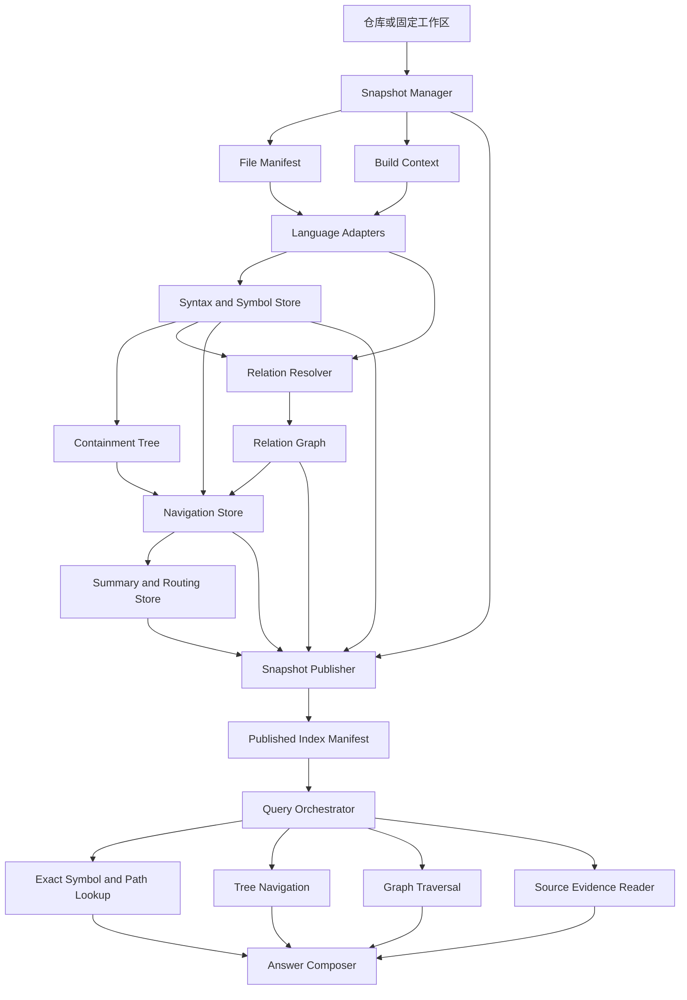
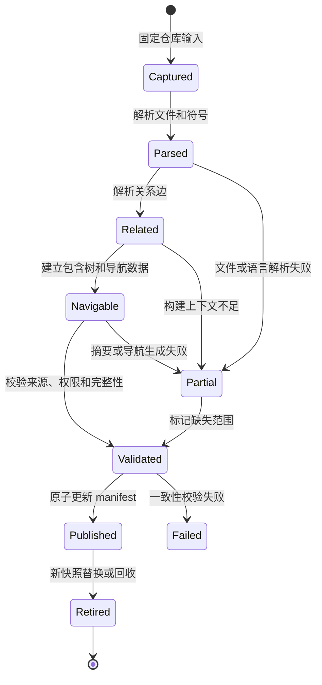

# CodeIndex 架构设计

## 1. 文档定位

CodeIndex 是一个面向大型代码仓库的结构化分析索引。它借鉴 PageIndex 的核心思想：先建立可导航的层级结构，再由查询代理按需展开相关节点，最后只读取能够支撑结论的原始内容。

代码仓库与长文档的根本差异在于，目录和语法结构只能表达包含关系，调用、引用、继承、实现和测试覆盖关系会跨越文件并形成环。因此 CodeIndex 采用三种结构协同工作：

- **快照模型**固定查询所看到的仓库版本。
- **包含树**负责从仓库、目录、文件导航到符号。
- **关系图**负责表达跨文件和跨符号关系。

摘要和路由信息属于可重建的派生数据。源码、解析结果和关系边才是代码事实的来源。

本文是候选架构设计，说明 CodeIndex 的稳定边界和落地路径，不替代具体语言解析器、API 文档或部署方案。

## 2. 目标与边界

### 2.1 目标

CodeIndex 应帮助用户回答以下类型的问题：

- 某个功能、接口或配置项在哪里实现。
- 一个入口经过哪些模块和符号。
- 某个类、函数或模块负责什么。
- 某个符号有哪些调用者、实现者、引用处或测试。
- 一个变更会影响哪些代码范围。
- 某个结论对应哪个仓库版本、文件、符号和源码范围。

查询结果必须能回到固定快照中的源码证据。模型可以帮助选择路径、归纳含义和组织答案，但不能替代确定性索引来证明符号存在或关系成立。

### 2.2 首期范围

首期以单仓库、固定快照和有限语言为边界，提供：

- 本地仓库快照索引。
- 目录、文件、类、函数和方法的包含树。
- 一个确定性解析器适配器，首期可从 Python AST 开始。
- 文件级降级索引，保证无法解析的文件仍可定位。
- 符号名、限定名、签名、源码范围和内容摘要。
- 导入、调用、继承、实现、引用和测试关系的统一接口，未支持的关系允许为空或标记为未知。
- 结构优先的查询工具和精确源码读取工具。
- 带快照、路径、符号和行范围的证据引用。
- 增量更新和原子发布。

### 2.3 不在首期范围内

以下能力需要更完整的编译上下文或更高的运行成本，暂不作为首期承诺：

- 所有语言的完整跨语言调用图。
- 无构建配置时的完整类型推导和数据流分析。
- 实时监听工作区并持续发布部分索引。
- 自动执行仓库命令、构建命令或测试命令。
- 跨多个仓库的统一关系图。
- 以 LLM 摘要或向量相似度作为代码事实的唯一来源。
- 对所有历史提交进行默认索引。

## 3. 设计原则

### 3.1 事实与导航分离

代码事实包括源码内容、语法节点、符号出现位置和关系边。导航信息包括目录树、节点摘要、路由词和候选排序。导航信息可以失效和重建，不能反向覆盖事实数据。

### 3.2 版本先于查询

每次查询开始时固定一个不可变快照和一个权限视图。查询过程中读取的源码、符号、关系和摘要必须属于同一快照。可变分支名只能用于解析快照，不能作为查询证据。

### 3.3 确定性解析优先

目录、文件、符号和源代码范围由文件系统、Git、AST、语言服务器或编译器工具产生。LLM 只负责摘要、意图归纳、查询分类和有限的候选排序。

### 3.4 树负责缩小范围，图负责表达关系

沿目录和语法包含树可以回答“代码在哪里”。沿关系图可以回答“代码如何连接”。两者不能互相替代，也不能把调用边伪装成树的父子关系。

### 3.5 证据必须可复核

每一个关键结论都应关联到当前快照内的源码范围或确定性关系边。摘要可以作为导航依据，但不能成为“符号存在”“没有调用者”或“代码一定如此”的唯一证据。

### 3.6 部分结果必须显式表达不完整

解析失败、缺少构建配置、语言插件缺失和权限裁剪都会造成覆盖范围不完整。系统必须说明缺失原因，不能把“索引中没有结果”解释成“代码中不存在”。

## 4. 总体架构



架构分为六个逻辑层：

| 层 | 责任 | 主要输出 |
| --- | --- | --- |
| 快照层 | 固定仓库版本、文件集合和构建上下文 | `Snapshot`、文件清单 |
| 解析层 | 解析语法、声明、定义和源代码范围 | 符号事实、语法事实 |
| 关系层 | 解析跨文件和跨符号关系 | 带证据的关系边 |
| 导航层 | 建立目录树、符号树和路由信息 | 包含树、摘要、关键词 |
| 发布层 | 校验并原子发布一组一致的索引 | 已发布索引清单 |
| 查询层 | 在权限和预算约束下导航、取证和生成答案 | 答案、证据、不确定性 |

依赖方向必须保持为：快照层被解析层使用，解析层被关系层和导航层使用，发布层汇总各派生结果，查询层只读取已发布结果。解析器不能依赖查询模型，摘要不能回写符号事实。

## 5. 核心领域模型

### 5.1 Snapshot

`Snapshot` 表示一次可复核的仓库输入。它至少由以下内容共同决定：

- 规范化仓库身份。
- 固定 Git revision 或工作区内容摘要。
- 文件清单和每个文件的 blob digest。
- 子模块、Git LFS 和符号链接处理结果。
- 忽略规则和生成文件策略。
- 语言版本、编译数据库或其他构建上下文。
- 解析器版本和索引 schema 版本。

同一 Git commit 在不同构建参数、解析器版本或忽略规则下可能产生不同语义，因此不能只用 commit SHA 作为全部索引身份。

### 5.2 SourceFile 与 SourceSpan

`SourceFile` 表示快照中的一个文件及其内容状态。`SourceSpan` 表示源码证据范围，至少包含文件路径、起止字节、起止行列、blob digest 和快照身份。

行号便于用户阅读，字节范围和 blob digest 用于验证引用没有漂移。源范围可以重叠，代码的嵌套声明不应被强行切成互不相交的片段。

### 5.3 SymbolOccurrence 与 SymbolLineage

CodeIndex 必须区分当前快照中的符号出现和跨版本的符号演化：

- `SymbolOccurrence` 是当前快照内的确定性事实，绑定语言、限定名、签名、源范围和解析上下文。
- `SymbolLineage` 是跨版本匹配的推断结果，用于表示重命名、移动或重构前后的可能关联。

当前快照内的唯一身份不能依赖树遍历顺序，也不能由 LLM 生成。跨版本关联允许不确定性和一对多结果，不能覆盖当前快照内的事实身份。

### 5.4 ContainmentTree

包含树表达稳定的导航层级：

```text
Repository
└── Directory
    └── File
        └── Module
            └── Class
                └── Function or Method
```

树节点保存节点类型、显示名称、稳定引用、源范围、父节点和摘要引用。树只表达“属于或包含”，不表达调用、引用和继承。

对无法解析的文件，树至少保留文件节点，并附加解析状态和错误信息。对过大的文件，导航层可以按模块或确定性范围分层，但不能删除符号身份。

### 5.5 RelationGraph

关系图由带类型的有向边组成。首期关系类型包括：

- `imports` 或 `includes`
- `calls`
- `references`
- `inherits`
- `implements`
- `tested_by`
- `configures`

每条边都必须保存来源符号、目标符号或未解析目标、关系类型、来源 `SourceSpan`、解析上下文、状态和可信度。关系状态至少区分 `resolved`、`unresolved`、`conditional` 和 `unsupported`。

“没有一条已解析的边”不等价于“确定没有关系”。查询结果必须能够区分这两种情况。

### 5.6 NavigationSummary

摘要是由一个节点及其可见子节点生成的派生数据。摘要必须绑定输入 digest、快照、模型、提示模板和生成状态。父节点任一有效子节点变化、失效或变得不可见时，父摘要必须重新生成或标记为过期。

摘要只用于：

- 帮助用户和模型理解模块范围。
- 生成路由词和候选排序。
- 在不读取全文时提供结构概览。

摘要不能单独用于证明代码事实。

## 6. 索引生命周期



### 6.1 全量索引

1. 固定仓库输入并生成 `Snapshot`。
2. 建立文件清单、内容摘要和语言分类。
3. 对支持的语言运行解析器，产生符号和语法范围。
4. 根据构建上下文解析跨文件关系。
5. 建立目录树、文件树和符号树。
6. 从叶节点向上生成摘要和路由信息。
7. 运行来源、范围、关系和权限校验。
8. 写入不可变索引包，并通过一次 manifest 更新发布。

### 6.2 增量更新

增量更新不是简单地重新解析 Git diff 中的文件。它必须执行以下工作：

1. 比较新旧快照的文件 digest、构建上下文和解析器版本。
2. 重新解析受影响文件。
3. 根据 imports、includes、继承、实现、调用和配置关系计算反向影响闭包。
4. 重新解析受影响关系边。
5. 使受影响符号、树节点和父级摘要失效。
6. 重新生成失效范围内的导航数据。
7. 对新索引执行完整性校验。
8. 将新版本发布为新的不可变索引，保留旧版本供正在进行的查询完成。

以下变化至少需要扩大失效范围：

- 文件内容或路径变化。
- 构建参数、语言版本或生成代码变化。
- 解析器、索引 schema 或关系解析器变化。
- 被其他文件导入、包含、继承或实现的公共符号签名变化。
- 权限视图变化。

## 7. 查询架构

查询由 `Query Orchestrator` 统一负责，顺序如下：

1. 解析仓库、快照和调用主体。
2. 固定查询快照和权限视图。
3. 判断问题类型：路径定位、符号查找、结构探索、关系分析、变更影响或综合分析。
4. 选择相应索引：精确符号索引、词法索引、包含树或关系图。
5. 在候选生成和图遍历前执行权限过滤。
6. 沿树或图逐步展开，遵守节点数、源码 token 数、图深度和时间预算。
7. 读取最小必要的源码范围。
8. 由模型组织答案，明确区分源码事实、关系推断和未确认内容。
9. 对答案中的每个关键判断生成证据引用。
10. 返回快照、证据、覆盖状态和不确定性。

### 7.1 查询路由策略

| 查询类型 | 首选索引 | 模型作用 |
| --- | --- | --- |
| “这个函数在哪里” | 精确符号和路径索引 | 处理同名候选和用户语义 |
| “这个模块负责什么” | 包含树和摘要 | 选择需要读取的源码范围 |
| “谁调用了它” | 关系图 | 解释调用链和未解析边 |
| “哪些类实现接口” | 继承和实现关系 | 汇总多条确定性边 |
| “配置如何影响流程” | 配置关系、引用关系和调用图 | 组织跨文件证据 |
| “某次改动影响什么” | 新旧快照差异和反向关系图 | 解释影响范围和不确定性 |

LLM 可以选择下一步展开节点，但工具层必须限制它只能访问已授权快照中的索引和源码范围。模型不能自行构造路径、行号或关系边。

### 7.2 证据格式

每条证据至少包含：

```json
{
  "snapshot_id": "snapshot:repo:content-digest",
  "path": "src/parser.py",
  "symbol_id": "symbol-occurrence-id",
  "symbol": "Parser.parse",
  "start_line": 42,
  "end_line": 68,
  "start_byte": 1200,
  "end_byte": 1870,
  "blob_digest": "sha256:...",
  "source": "当前快照中的源码片段",
  "kind": "source"
}
```

关系证据还应包含关系类型、边状态、来源位置、目标符号和解析上下文。答案必须携带 `coverage` 和 `uncertainties`，让用户知道索引是否完整以及哪些结论仍是推断。

## 8. 存储与发布

建议把索引拆成可独立校验的分片，不把全仓库源码和所有关系塞进一个 JSON 文件：

```text
indexes/<repository-id>/
  snapshots/<snapshot-id>/
    manifest.json
    files/<file-id>.json
    source/<blob-digest>
    symbols/<partition>.jsonl
    containment/<partition>.jsonl
    relations/<partition>.jsonl
    navigation/<partition>.jsonl
    summaries/<partition>.jsonl
  published.json
```

`manifest.json` 描述该快照的输入指纹、索引版本、分片、完整性状态和权限视图。`published.json` 只通过原子替换指向已经校验完成的快照。

查询只读取 `published.json` 指向的版本。索引构建失败或进程中断时，不得修改当前已发布指针。旧快照可以保留到垃圾回收阶段，但不能被新查询隐式拼接到新快照中。

PageIndex 的本地存储已经验证了目录隔离、原子 JSON 写入和文件锁的实用性。CodeIndex 可以沿用这些基础设施思路，但需要增加快照 manifest、分片校验和跨数据集原子发布。

## 9. 权限与安全

权限是查询边界的一部分，不是答案生成后的过滤步骤。权限过滤必须发生在：

- 候选节点生成前。
- 摘要读取前。
- 关系图遍历前。
- 源码读取前。
- 模型上下文构造前。
- 结果缓存命中前。

父节点摘要可能包含子目录信息，因此共享摘要缓存必须绑定可见性范围或权限视图版本。关系边也可能泄露内部符号名称，不能因为用户看不到源文件就允许其访问该边。

源码、注释、配置、测试数据和工具输出都属于不可信输入。它们可以作为模型分析的材料，但不能覆盖系统指令、改变工具权限或触发未经授权的命令执行。

## 10. PageIndex 设计的迁移关系

| PageIndex 思路 | CodeIndex 迁移方式 |
| --- | --- |
| 文档树 | 仓库、目录、文件和符号的包含树 |
| 页范围 | 文件路径、字节范围、行列范围和 blob digest |
| 节点摘要 | 绑定输入 digest 的导航摘要 |
| 先看结构再读正文 | 先浏览树和关系，再读取精确源码范围 |
| 按树成本展开 | 按源码 token、节点数、图扇出和查询预算展开 |
| 合并后保留 `key_items` | 合并导航摘要时保留符号 ID、路径、签名和别名 |
| 页面内容存储 | 快照源码 blob 和按范围读取 |
| 文档状态 | 快照完整性、解析状态和发布状态 |
| LLM 生成结构补充 | LLM 只补充摘要和语义标签，不能生成确定性符号事实 |

`pageindex/tree_optimize.py` 中“展开只有在预期读取成本下降时才进行”的原则可以迁移，但成本单位需要改成源码 token、候选节点数和关系图扇出。PageIndex 的页级 `start_index/end_index`、顺序编号和同页合并规则不能直接复用。

## 11. 系统不变量

1. 每个已发布索引只属于一个不可变 `snapshot_id`，查询不得跨快照拼接事实。
2. 每个符号出现都必须能定位到当前快照中的文件、blob、字节范围和解析器版本。
3. 当前快照内的符号身份与跨版本 lineage 身份必须分离。
4. 包含树只能表达包含关系，调用、引用、继承和测试关系必须存储为独立图边。
5. 每条 `resolved` 关系边必须有来源证据、解析上下文和状态。
6. 任一输入文件、构建上下文、解析器或 schema 变化都必须触发对应派生数据失效。
7. 父摘要依赖的子节点变化或不可用时，父摘要必须重建或标记过期。
8. 权限过滤必须早于候选生成、摘要读取、图遍历和模型上下文构造。
9. 答案中的关键结论必须引用当前授权快照中的源码或确定性关系证据。
10. 部分索引必须携带覆盖范围和缺失原因，不能静默返回空结果。
11. 新索引必须完成一致性校验后才能通过一次 manifest 更新发布。
12. 仓库内容不得改变系统指令、越权读取源码或触发未授权工具操作。

## 12. 首期实现路线

### 阶段一：快照和符号事实

建立本地快照、文件清单、源码 blob、Python AST 符号索引和精确引用。先验证“能找到正确代码并证明引用有效”。

### 阶段二：包含树和 PageIndex 风格导航

建立仓库到符号的包含树，增加叶节点摘要和父节点摘要。实现结构浏览、精确范围读取和基于预算的按需展开。

### 阶段三：关系图

先实现导入、调用、继承、实现和测试关系中的一部分。每条边保存来源证据和解析状态，明确区分未知与不存在。

### 阶段四：增量索引和原子发布

实现文件 digest 对比、反向依赖失效、摘要失效、索引分片和 manifest 发布。用真实提交序列验证快照一致性和旧证据失效。

### 阶段五：多语言和构建上下文

按实际仓库需求增加 Tree-sitter、语言服务器或编译器适配器，接入编译数据库和条件编译上下文。每种语言必须独立报告覆盖能力，不宣称全库完整分析。

## 13. 验收指标

使用 PageIndex 自身和两个规模不同的 Python 仓库建立问题集，至少覆盖入口定位、配置追踪、调用者查找、实现关系、测试定位和变更影响。

建议首期验收以下指标：

- 正确文件或符号出现在前五个候选中的比例达到约定目标。
- 100% 返回的引用都能在对应快照中解析到真实源码范围。
- 旧快照或文件 digest 不匹配时，系统不会返回看似有效的旧行号证据。
- 查询能够区分“没有找到关系”和“关系索引不完整”。
- 相同快照的重复查询不会产生跨版本证据。
- 对语法错误、重复名称、嵌套函数、多行声明、Unicode 路径、软链接、生成目录和二进制文件有明确处理结果。
- 模型上下文只包含经过权限过滤的节点、关系和源码范围。
- 与 `rg` 加人工阅读的基线相比，CodeIndex 能减少定位和取证所需的源码范围。

## 14. 主要风险与应对

| 风险 | 应对 |
| --- | --- |
| 动态语言或反射导致关系缺失 | 显式记录 unresolved，不把缺失解释为不存在 |
| 大仓库索引规模过大 | 分片存储、惰性加载、按权限和查询范围读取 |
| 摘要陈旧 | 摘要绑定输入 digest，并沿包含树向上失效 |
| 文件移动和符号重命名 | 当前出现身份与跨版本 lineage 分离 |
| 构建目标不同导致解析结果不同 | Snapshot 绑定构建上下文，关系边保存解析上下文 |
| 权限泄露 | 在候选和图遍历前过滤，缓存绑定权限视图 |
| 部分索引造成错误否定 | 显式 coverage、status 和 uncertainty |
| 仓库内容提示注入 | 源码只作为不可信数据，工具权限由系统层控制 |

## 15. 来源与决策依据

本设计参考当前 PageIndex 的以下事实：

- [README.md](/data/github/PageIndex/README.md) 将系统核心定义为树索引和基于树的推理检索。
- [pageindex/page_index_md.py](/data/github/PageIndex/pageindex/page_index_md.py) 展示了从结构标题、行号和正文范围构建层级树的思路。
- [pageindex/tree_optimize.py](/data/github/PageIndex/pageindex/tree_optimize.py) 展示了按导航成本决定树展开和合并的原则。
- [pageindex/local_store.py](/data/github/PageIndex/pageindex/local_store.py) 展示了本地索引目录、原子写入、清单和锁的基础实现。
- [pageindex/agent_tools.py](/data/github/PageIndex/pageindex/agent_tools.py) 展示了结构优先、正文按需读取和工具结果统一封装的交互方式。

关键架构决策如下：

- 采用“快照 + 事实索引 + 导航派生数据”的分层，而不是把所有内容放入单棵摘要树。
- 采用“包含树 + 关系图”，而不是用树表达所有代码关系。
- 采用确定性解析产生符号和关系证据，LLM 只负责导航和归纳。
- 采用不可变快照和原子发布，避免索引构建过程中产生混合版本。
- 采用显式完整性和不确定性，避免把索引缺失误报为代码事实。
