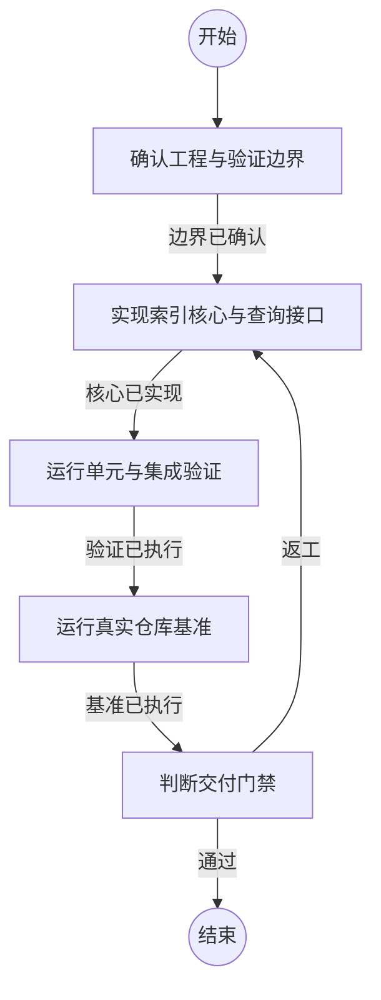

## 确认工程与验证边界

```新建Agent
请根据目标架构、当前工程和实际工具链确认 CodeIndex 的实现边界、语言适配范围、索引一致性门禁和基准问题集。只读检查，不修改文件。输出可执行的工程约束和验证标准。
```

### 边界已确认

已确定索引、查询、增量更新和基准的实现范围。

## 实现索引核心与查询接口

```新建Agent
请按已确认的 CodeIndex 架构实现项目。优先完成快照、文件清单、确定性符号索引、包含树、关系图、原子发布、查询工具和文档。保持 Node.js 技术栈，LLM 为可选适配器，所有源码证据必须可复核。完成后列出修改文件和验证命令。
```

### 核心已实现

已完成可运行的索引和查询实现。

## 运行单元与集成验证

```执行自定义命令
{
  "command": "npm",
  "args": ["test"],
  "stdin": {"task": "{outcome}"}
}
```

### 验证已执行

单元测试和集成测试已经执行，结果可供真实仓库基准使用。

## 运行真实仓库基准

```执行自定义命令
{
  "command": "npm",
  "args": ["run", "benchmark"],
  "stdin": {"task": "{outcome}"}
}
```

### 基准已执行

已获得索引规模、索引耗时、查询耗时、候选召回率、证据有效率和基线对比结果。

## 判断交付门禁

```新建Agent
根据实现结果、测试结果和真实仓库基准判断是否满足交付：源码索引可复核、快照一致性成立、查询能返回证据、真实复杂仓库可用，并相对全文扫描基线在定位成本或查询上下文规模上有显著优势。若不满足，指出具体失败指标和最小返工范围；若满足，确认最终交付清单。
```

### 通过

实现、验证和基准均达到交付门禁。

### 返工

根据失败指标返回实现阶段，修复后重新验证和基准测试。
