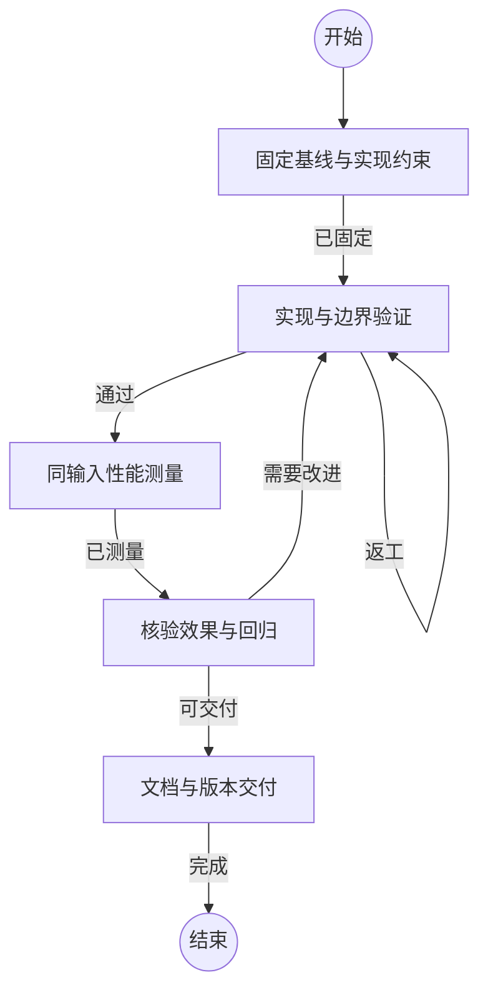

## 固定基线与实现约束

```新建Agent
针对 {var.任务} 固定代码基线、源码清单、工具版本和资源预算。按阶段定位瓶颈，核验并发依赖和更新复用前提。明确查询结果、证据字节范围、快照隔离、失败清理与原子发布不变量，优先选择简单可验证的改动。
```

### 已固定

基线可复现，实现边界和检查方式明确。

## 实现与边界验证

```复用Agent
实施已确定的优化，补充有实际风险的回归测试。验证串行和并行结果、连续修改、增删改名、依赖闭包及失败后的旧快照可用性。同步调整调用方和文档。每项同类问题最多进行三轮有证据支持的修复，再明确收缩实现范围或保留已验证路径。
```

### 通过

功能测试和安全边界检查通过，可测量最终实现。

### 返工

存在可定位的正确性、资源或清理缺陷。

## 同输入性能测量

```复用Agent
使用固定输入、新输出和一致缓存条件串行测量全量、查询、无变化及单文件更新。记录阶段、CPU、进程内存、产物大小、成功与失败。保留基线，验证查询和关系证据，恢复测试输入及已发布状态。
```

### 已测量

目标组合均有可复核结果，输入恢复已验证。

## 核验效果与回归

```复用Agent
对比优化前后数据，区分实测收益与估计，核验结果等价、证据、资源预算及小仓开销。发现回归时定位并控制补测范围，最多三轮改进。仅保留正确且经测量合理的优化，记录未采用方案及原因。
```

### 需要改进

存在可修复且影响交付的回归或测量缺口。

### 可交付

优化效果、正确性和适用范围均有证据。

## 文档与版本交付

```复用Agent
完成结果报告和使用文档，审查改动并提交、合并到默认分支。按授权同步远端，清理任务工作目录，核验最终版本与运行状态。
```

### 完成

代码、文档和原始结果已交付，默认分支与工作区状态明确。
