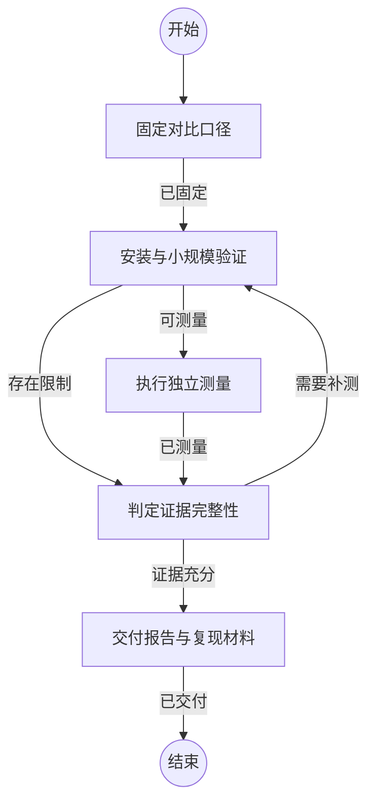

## 固定对比口径

```新建Agent
根据任务 {var.任务} 固定工具版本、仓库提交及文件清单。区分共同能力和扩展能力，明确建库结束条件、查询结果验证、缓存条件、资源范围、更新与恢复方法。声明每次运行的时间和内存上限，保留原始输入与结果。
```

### 已固定

版本、输入、指标、限制和输出位置均可追踪。

## 安装与小规模验证

```复用Agent
在隔离环境安装工具，先用小仓库验证建库完成状态、查询命令和结果格式。若失败，区分环境问题、配置问题与工具限制，每个相同问题最多尝试三种有证据支持的修复。保留失败日志；不改变对比对象的实现来掩盖失败。
```

### 可测量

工具已能完成正确的小规模索引与查询。

### 存在限制

已明确无法继续的环境或产品限制，并保留诊断证据。

## 执行独立测量

```复用Agent
逐个运行固定输入的全量构建、共同查询及受支持的关系查询。建库计时包含全部必要后处理；避免多个被测任务争用资源。验证结果的路径、行号和源码，记录覆盖、磁盘、进程及子进程资源。测量无变化和单文件更新，结束后恢复输入与已发布状态。超过预算时明确报告超时或资源限制，不将未完成索引计为成功。
```

### 已测量

所有可运行组合均有结果或明确失败记录，输入恢复已核验。

## 判定证据完整性

```复用Agent
逐项核对输入一致性、完成条件、能力范围、资源口径、查询正确性和恢复状态。发现配置或测量问题时明确最小补测范围；同一问题累计三次合理尝试仍失败时，作为已证实限制交付，不无限重试。禁止用不支持的能力或未完成任务制造性能排名。
```

### 需要补测

存在能够修复且影响结论的测量缺口。

### 证据充分

各组合有可复核结果、明确限制或带证据的失败，足以形成分项结论。

## 交付报告与复现材料

```复用Agent
整理中文报告、复现脚本和原始结果，分别解释共同能力及扩展能力。核对数据与文档链接，提交到项目版本库并按任务授权交付。清理本次临时修改，保留必要基准产物。
```

### 已交付

报告和原始记录已保存，版本库与基准输入状态可核验。
